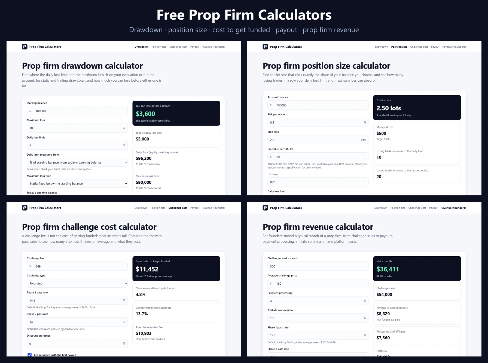

# Free Prop Firm Calculators: Drawdown, Position Size, Challenge Cost, Payout, Revenue



**Free, open-source calculators for prop traders and prop firm founders.** Work out your daily loss and trailing drawdown floors, the lot size for a given risk, what it really costs to get funded, your payout after the profit split, and a month of a prop firm's revenue. No sign-up, no tracking, MIT licensed, and embeddable on your own site.

[**Open the calculators**](https://propsim-enterprise.github.io/prop-firm-calculators/) · [Embed one](#embed-a-calculator) · [Run it yourself](#run-it-yourself) · [PropSim prop firm software](https://propsim.markets/?utm_source=github&utm_medium=readme&utm_campaign=prop-firm-calculators)

## The calculators

| Calculator | What it answers |
|---|---|
| [**Prop firm drawdown calculator**](https://propsim-enterprise.github.io/prop-firm-calculators/drawdown/) | Where are my daily loss floor and maximum loss floor, static or trailing, and how much can I still lose? |
| [**Prop firm position size calculator**](https://propsim-enterprise.github.io/prop-firm-calculators/position-size/) | What lot size risks exactly X% of my balance, and how many losing trades in a row do my limits allow? |
| [**Prop firm challenge cost calculator**](https://propsim-enterprise.github.io/prop-firm-calculators/challenge-cost/) | With real pass rates, how many attempts and how much money does getting funded take on average? |
| [**Prop firm payout calculator**](https://propsim-enterprise.github.io/prop-firm-calculators/payout/) | What does my profit split pay after a refunded fee and withdrawal fees, and how much profit do I need for a target payout? |
| [**Prop firm revenue calculator**](https://propsim-enterprise.github.io/prop-firm-calculators/revenue/) | For founders: what does a month of challenge sales leave after payouts, processing, affiliates and platform costs? |

Every calculator keeps its inputs in the URL, so you can share a link with your numbers.

## The formulas

**Drawdown.** Daily floor = the day's opening level − the daily limit. The limit is a percentage of the starting balance, of the day's opening balance, or of the higher of the opening balance and equity, depending on the firm. Maximum loss floor: static = starting balance − max loss; trailing = highest equity − max loss; trailing with lock stops rising at the starting balance.

**Position size.** `lots = (balance × risk %) ÷ (stop loss pips × pip value per lot)`, rounded down to the lot step so risk never exceeds the target.

**Challenge cost.** `chance per attempt = phase 1 pass rate × phase 2 pass rate`, `expected attempts = 1 ÷ chance`, `expected cost = fee + (attempts − 1) × retry fee`. The default pass rates are the [PropSim Prop Trading Index](https://propsim.markets/prop-trading-index?utm_source=github&utm_medium=readme&utm_campaign=prop-firm-calculators) averages, also published as the open [prop firm pass rates dataset](https://github.com/PropSim-Enterprise/prop-firm-pass-rates).

**Payout.** `payout = profit × split + refunded fee − withdrawal fee`.

**Revenue.** Sales − payment processing − affiliate commission − platform costs − payouts, where payouts = challenges × phase 1 rate × phase 2 rate × share paid out × average payout.

The maths lives in small pure functions in [`src/lib/`](src/lib/), with tests in [`src/lib/calculators.test.ts`](src/lib/calculators.test.ts).

## Embed a calculator

Each calculator page has its embed code. Add `?embed` to a calculator's address to show only the calculator:

```html
<iframe src="https://propsim-enterprise.github.io/prop-firm-calculators/drawdown/?embed" width="100%" height="820" style="border:0" loading="lazy" title="Prop firm drawdown calculator"></iframe>
<p><a href="https://propsim-enterprise.github.io/prop-firm-calculators/drawdown/">Prop firm drawdown calculator</a> by <a href="https://propsim.markets">PropSim</a></p>
```

## Run it yourself

```bash
git clone https://github.com/PropSim-Enterprise/prop-firm-calculators.git
cd prop-firm-calculators
npm install
npm run dev     # local server
npm test        # the formulas' tests
npm run build   # type-check, test and build to dist/
```

It is plain TypeScript and HTML with no framework. The page copy is generated by `scripts/pages.mjs` (`npm run pages`). The [workflow](.github/workflows/deploy.yml) publishes `dist/` to GitHub Pages on every push to `main`.

## Notes

- Prop firm rules differ. The drawdown calculator covers the common variants; check your firm's exact rules.
- The pass rates describe accounts on firms using the PropSim platform, not every prop firm, and they are averages.
- Nothing here is financial advice.

## License

[MIT](LICENSE) © PropSim.

---

Made by [PropSim](https://propsim.markets/?utm_source=github&utm_medium=readme&utm_campaign=prop-firm-calculators), white-label prop firm software. More free tools: [prop firm landing page templates](https://github.com/PropSim-Enterprise/prop-firm-landing-page-templates) · [prop firm pass rates dataset](https://github.com/PropSim-Enterprise/prop-firm-pass-rates).
